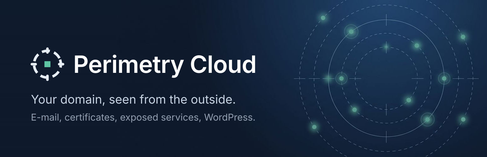
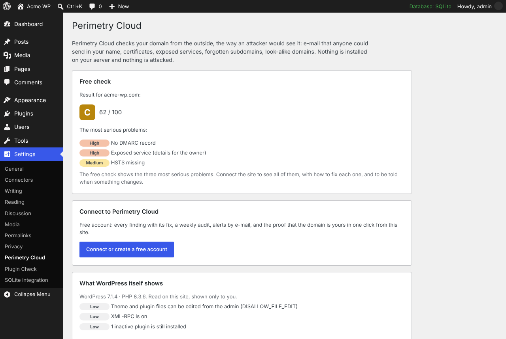
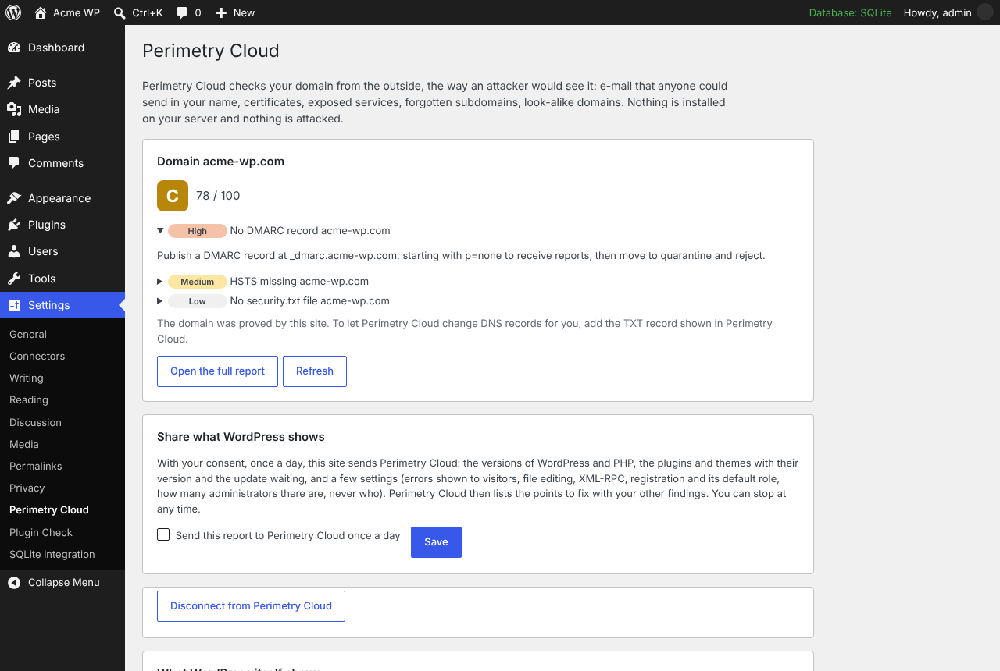
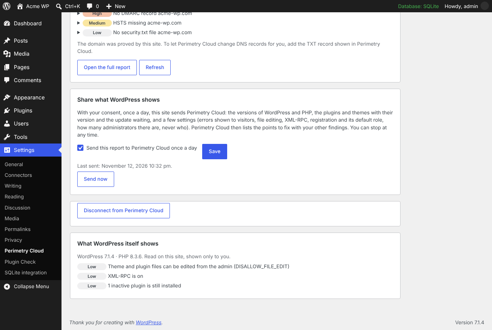
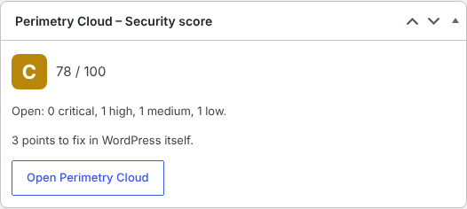

# Perimetry Cloud – Security Score for WordPress

[](https://github.com/securissima/perimetry-cloud-wordpress/actions/workflows/ci.yml)




The security score of your site's domain, seen from the outside, in the WordPress admin. A free check needs no account.

[Perimetry Cloud](https://perimetry.cloud) checks a domain the way an attacker would see it from the internet, and says in plain words what to fix:

- e-mail that anyone could send in your name (SPF, DKIM, DMARC);
- certificates about to expire or badly configured;
- exposed services and forgotten subdomains;
- look-alike domains registered to trick your customers;
- and, in WordPress itself: updates waiting, an unsupported PHP version, errors shown to visitors, file editing from the admin, XML-RPC, risky registration settings.

Nothing is installed on your server and nothing is attacked: Perimetry Cloud only reads what anyone can read on the internet.

## Features

- **Free check, no account.** One click gives the score of the domain and its three most serious problems, in about two minutes. Limited to the site's own domain, once a week.
- **Connection to a Perimetry Cloud workspace** (Free plan included). Every finding with its fix, a weekly audit and alerts. The key the site receives can only read its own domain.
- **Ownership proof by the site.** The domain is proved in one click, without touching the DNS. Actions that change DNS records still require the TXT record.
- **WordPress report, with consent only.** Once a day, if an administrator ticks the box: versions, plugins and themes with their pending update, and a few settings. The number of administrators, never who they are. No content, no user data, no visitor data.
- **Dashboard widget** with the grade and the open findings.
- **English, French and German.**

## Screenshots

| Free check | Connected site |
| --- | --- |
|  |  |
| **What WordPress itself shows** | **Dashboard widget** |
|  |  |

## Installation

1. Download the latest release, or build the zip (below), and upload it in **Plugins › Add New › Upload Plugin**.
2. Activate it, then go to **Settings › Perimetry Cloud**, or look at the widget on the dashboard.
3. Press **Check my domain** for the free check, or **Connect** to see everything and be alerted.

Requirements: WordPress 6.5 or later, PHP 7.4 or later, a site served over HTTPS. To prove the domain from the site, the site must be at the domain itself or at its `www`; other sites prove it with the DNS record.

## How it talks to Perimetry Cloud

Nothing is sent until an administrator presses a button. The full list is in the **External services** section of [`perimetry-cloud/readme.txt`](perimetry-cloud/readme.txt); in short:

| Action | What is sent | What the site shows |
| --- | --- | --- |
| Free check | The site's address | A one-time code at `/?perimetry_proof=…`, so the service knows the request comes from this site |
| Connect | Nothing from the site: the administrator signs in in the browser, and the site receives a read-only key for its own domain | — |
| Prove ownership | — | A code at `/?perimetry_verify=1`, read again once a day |
| Results | The key, to read the score and findings | — |
| WordPress report (opt-in) | Versions, plugins and themes, a few settings, the number of administrators | — |

The plugin answers the two proof addresses with a single line of plain text, never cached nor indexed, and only when a check is expected. Nothing runs for visitors.

Uninstalling the plugin deletes everything it kept. Press **Disconnect** first to revoke its key.

- Terms of service: https://perimetry.cloud/legal/terms/
- Privacy policy: https://perimetry.cloud/legal/privacy/
- Help: https://perimetry.cloud/help/wordpress-plugin/

## Repository layout

| Path | Contents |
| --- | --- |
| `perimetry-cloud/` | The plugin, as published on wordpress.org |
| `tests/unit.php` | Unit tests, run on a stand-in for WordPress (`tests/harness/wp-stub.php`) |
| `tests/harness/router.php` | A PHP built-in server router that shows the plugin's pages in a frame that looks like the WordPress admin, without WordPress |
| `tools/` | `strings.mjs` lists the translatable strings; `build-l10n.mjs` builds the `.pot`, `.po`, `.mo` and `.l10n.php` files from `tools/translations.json` |
| `.wordpress-org/` | Banner, icon and screenshots for the wordpress.org directory (not part of the plugin) |

## Development

```bash
# Syntax and unit tests
find perimetry-cloud tests -name '*.php' -print0 | xargs -0 -n1 php -l
php tests/unit.php

# Translations (Node.js 20 or later), after changing a string or tools/translations.json
node tools/build-l10n.mjs

# Look at the plugin's pages without WordPress
php -S 127.0.0.1:8099 tests/harness/router.php

# Build the zip
mkdir -p dist && zip -r dist/perimetry-cloud.zip perimetry-cloud -x '*/.*'
```

To try it in a real WordPress against a local copy of the service, set the service address in `wp-config.php`:

```php
define( 'PERIMETRY_CLOUD_API', 'http://127.0.0.1:3000' );
```

Before each release: run the official [Plugin Check](https://wordpress.org/plugins/plugin-check/) plugin, then update `Version` in `perimetry-cloud.php`, `Stable tag` and the changelog in `readme.txt`.

## Contributing

Issues and pull requests are welcome. Please keep changes small, run the unit tests and rebuild the translation files when a string changes. Translations into other languages are welcome too: add them to `tools/translations.json`.

## Security

Please do not open a public issue for a vulnerability. See [SECURITY.md](SECURITY.md).

## License

GPL-2.0-or-later. See [LICENSE](LICENSE).
